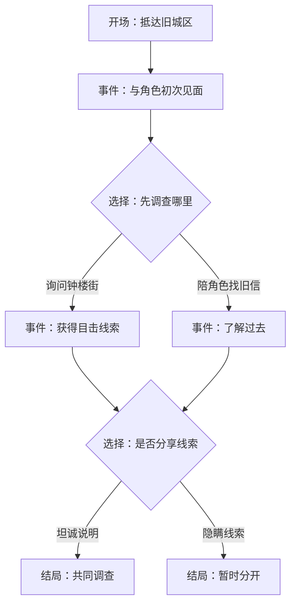

# 酒馆剧情指南：产品需求文档

## 当前产品基线（2026-11-14，已授权分阶段实施）

用户确认先按“原作剧情还原 + AI 辅助路线生成 + 用户手动编辑确认”推进，后续按实际体验调整。详细产品方案、数据契约草案、阶段与验收见 [Galgame 产品改造方案](galgame-product-plan.md)。该方案是后续改造基线，不代表现有版本已实现；与下方历史版本要求冲突时，以本节及该方案为准。

- 保留方便查看角色卡及世界书的资料阅读能力；重点补齐事件整理、可编辑路线、共享事件、未连接事件及可靠保存，不推倒现有实现。
- 资料与事件分离；不按人物名、条目顺序、布局位置或分组自动连线。没有完整路线是正常输入状态，允许保存路线片段。
- 原作明确、AI 推断、AI 创作、人工内容分别标识；审核状态独立。未确认 AI 候选只能在草稿预览展示。
- 素材库调整为以 CG／关键场景的剧情价值为核心：整理发生了什么、参与人物、前置条件、选择、关系变化及后果。服装、姿态、氛围是辅助信息，不能代替核心剧情。
- 对用户提供的成人题材文本，区分原文保存、已有内容提取与新增创作；不因成人话题或敏感词整段排除，不擅自把关键情节改成无关日常片段。提取不默认生成原创开场；原文与归纳分开，不伪造引用或补写细节。模型无法处理的部分明确报告，原始归档保持可读可导出，不用空结果冒充成功。
- P0：资料/事件分离、手动路线及核心场景素材闭环、安全重导入；P1：AI 关系候选、AI 路线草稿、人物路线及多结局；P2：完整工坊体验、新增聊天关联、自动进度及解锁。保留已有能力，新增优先级不意味着删除历史功能。
- 初次确认时仅更新产品与架构计划；随后用户授权实施，0.7.0已发布，当前推进0.8.0，具体完成与验证边界见 verification.md。新资料库与旧存档并存，迁移保留旧记录及恢复入口；不得把候选状态当作已发布。
- 2026-11-14 补充确认（FR-04/05/06/08）：桌面采用主动打开的三栏整理工作台（资料库／路线图／详情编辑），移动端优先阅读整理后的资料、事件和路线，编辑时切换单栏视图，不压缩三栏。先完成 P0，尤其资料与事件分离、连线来源可信、手动连线并保存；新增 AI 自动路线及聊天事件/进度识别后置，详见改造方案第6节。

## FR-10 原文片段优先（0.6.4）

用户要求素材库以聊天小说片段可靠入库为优先：无需AI保存/导出所选原文，标题与标签可查，角色卡/聊天/消息序号可定位，AI归纳独立。原文1–100条、总1M字符不截断，AI整理仍最多50条；AI调用前先保存raw，失败保持可读可导出。经确认保存AI结果时仅原子升级相同原文raw归档，不能覆盖不同消息或已整理版本。支持旧归档，无自动向其他AI工具上传。

## FR-06 移动端阅读排版（0.6.3）

按用户明确要求，以手机阅读适配重排悬浮界面。细长手机比例、顶栏收起/关闭，固定底栏阅读/资料设置/更多；低频管理与模型控件进入菜单，故事保存导出折叠，人物分类可紧凑选择。长人物档案首屏可开始阅读，主区域单独滚动，背景聊天仍可输入。

## FR-06 悬浮阅读（0.6.2）

用户参考图明确选择手机式悬浮效果：手册打开时聊天仍可操作，默认折叠资料设置，支持放大/恢复、收起悬浮球/恢复；收起不丢草稿、不取消任务，关闭沿用未保存确认与取消。窄屏保留底部聊天空间；资料分组、按钮与正文有独立间距。主动编辑弹窗仍可为模态。

## FR-02 / FR-04 / FR-06 分析资料交互修正（0.6.1）

用户确认：仅展示当前卡关联世界书（主绑定、额外绑定、聊天绑定；内嵌自动读取）；分析前按子角色及公共资料分组，支持搜索、全选/取消及组内批量选择，多人资料选择状态同步。
AI未提取事件时仍保留每条原始人物/设定资料卡，不将静态设定强行变为事件。生成分析中无效引用移除并显式降级为待核对推断，保留结构及严格导入校验；不伪造逐字引用。失败正文独立保留最近一次，主动查看，普通日志不包含；刷新/清空即删除。

版本：0.1｜日期：2026-11-13｜当前阶段：首版实现，具体验收状态见 verification.md。

## 1. 产品目标

面向使用 SillyTavern 中文角色卡的玩家，在酒馆内读懂故事、查看事件和分支，并获得互动方向。支持已有世界书的剧情整理，也支持没有世界书时围绕角色创作故事。以 Galgame 的章节、选择、分支和结局作为组织方式，实际游玩仍通过酒馆聊天进行。

用户已确认：中文界面；SillyTavern 扩展形态；通过 Git URL 安装；角色卡/世界书解析；时间线、地点事件、路线、聊天建议；无世界书时创作故事；分支流程图。

本文中的技术方案、容量目标及具体交互为建议默认值，后续实现前验证。本文不代表已完成兼容性测试或发布。

## 2. 问题与证据

用户导入角色卡后难以看清角色时间线、某地点发生的事情与原有故事路线；聊天容易偏离，玩家不知道怎样互动才能探索故事。现有调研仅核对公开文档，未安装实测，不能据此断言没有竞品。

参考项目：

- Story Tracker：追踪聊天中的场景状态。https://github.com/virgilianshailer/story-tracker
- Story Arc：规划未来情节并引导生成。https://github.com/coragon77/StoryArc
- Zeya Status Atelier：开场目录及世界书线路关联。https://github.com/jiuyi777/Zeya-Status-Atelier
- Saga：设定、时间与秘密管理。https://github.com/MentallyQuill/Saga

本项目的优先价值：开局即可获得中文、可核对、可编辑的剧情指南，而不是只在聊天后总结。

## 3. 产品边界

- 运行于 SillyTavern 页面，设置和主面板由扩展提供；不是独立聊天网站。
- Git 仓库地址为 https://github.com/liu5440/SillyTavern-StoryGuide ，在酒馆“安装扩展”中粘贴此 URL；实际发布及安装验证状态见 verification.md。
- 首版支持单角色聊天；群聊支持后置。
- 首版完整覆盖解析与创作、可编辑分支图、手动进度和主动请求互动建议。
- 自动判定聊天进度、严格路线约束、生成后审查及自动修复后置，不能承诺首版彻底消除跑偏。
- 不包含账户系统、云端社区、付费、图片/语音生成和独立服务端。
- 不自动执行世界书脚本，不要求酒馆助手、MVU 或其他插件作为首版依赖。

## 4. 核心概念与信息可信度

### 4.1 两种工作模式

**解析模式**：用户选择当前角色及需要分析的世界书，提取已明确写出的事件、关系、时间、地点、路线与条件。没有写出的关系可作为推断展示，但不能补成作者原设定。没有固定路线时明确显示“原资料未提供固定路线”。

**创作模式**：无世界书也可使用；以角色卡及用户填写的题材、基调、目标和边界生成故事草稿。已有世界书也可主动选择扩写，但原设定与新增内容分层保存。生成章节、冲突、选择、事件、分支和结局，用户审阅、编辑并采用后才成为游玩依据。

### 4.2 内容来源

每条事件、条件、关系和建议都必须标记来源类型：

| 类型     | 含义               | 约束                           |
| -------- | ------------------ | ------------------------------ |
| 原文明确 | 资料直接支持       | 包含可定位的来源及摘录         |
| 模型推断 | 模型解释或推测     | 显著标注，可修改，不能伪造引用 |
| 原创草稿 | 新增故事           | 未采用前不影响游玩             |
| 用户设定 | 玩家手动新增或修改 | 记录修改及版本                 |

聊天建议是建议，不是保证能触发事件的口令。实际语义条件与酒馆世界书激活机制分开展示：关键词、概率和扫描设置不等于剧情条件。

## 5. 用户流程

1. 进入角色聊天，从扩展设置或输入区菜单打开“剧情指南”。
2. 查看识别到的角色和资料列表，选择解析、创作或扩写。
3. 解析时选择资料范围；创作时填写简短故事意向，允许跳过并使用明确展示的默认值。
4. 显示资料量、分批处理计划及将使用的模型连接，点击生成。
5. 展示生成进度、可取消；失败保留已完成草稿，可重试失败批次。
6. 审阅故事概览、事件、地点、路线与流程图，核对来源、修正冲突并采用版本。
7. 游玩时查看当前节点、可探索方向及聊天建议，手动更新进度。
8. 随时保存、导入导出；刷新或切换角色后恢复对应资料。

无世界书不是报错场景：展示“未找到世界书，可基于角色创作故事”，并允许继续。如果角色卡也缺少有效描述，先输入最小人物设定，不能静默生成与角色无关的故事。

## 6. 功能与验收

### FR-01 宿主集成与资料选择（P0）

- 使用原生扩展清单与入口，在酒馆内显示中文面板。
- 0.2.1：扩展设置采用默认收起的原生风格折叠栏；聊天输入框旁的扩展（魔杖）菜单提供“剧情指南”快捷入口。两处打开同一面板，重复初始化不重复注册，清理时移除自有入口。
- 支持读取角色描述、背景、首条问候及可用的内嵌/关联世界书；具体字段须经宿主适配验证。
- 列出来源、条目数和包含状态。禁用条目默认不参与，可由用户显式纳入并保留禁用标记。
- 不默认扫描所有角色与全局资料；需要额外资料时由用户选择。
- 验收：有书、无书、空书、多个关联书、重复内嵌条目均可解释处理；不能把无权限/读取失败伪装成无书。

### FR-02 原设定解析（P0）

- 提取事件、人物、地点、相对时间、前后依赖、分歧、结局及触发条件。
- 时间缺失标未知；矛盾来源并列展示，不能自行裁定或编造精确日期。
- 每项事实可跳转来源摘要，含书名、条目 UID/角色字段、原文摘录及资料版本。
- 大书分批提取后合并、去重，保留来源映射和未完成批次，不静默截断。
- 验收：只有人设的卡不得展示“作者指定结局”；无依据的关系被标记推断；无效引用不可作为明确事实采用。

### FR-03 故事创作与扩写（P0）

- 输入：角色资料、故事主题、基调、篇幅偏好、玩家身份和希望避免的内容；非必填项提供可见默认值。
- 输出：故事梗概、章节目标、事件、选择、条件、分支和至少一个可达结局。
- 允许局部重生成；默认保留用户编辑及锁定节点，覆盖前提供差异预览。
- 原资料作为约束，新增内容标原创；冲突必须提示。
- 草稿、采用、归档是明确状态；失败、取消及部分完成不能自动采用。
- 验收：没有世界书可以完成“生成—编辑—采用—查看图”的闭环；新增结局不标为原文明确。

### FR-04 故事指南（P0）

- 中文展示概览、时间线、人物、地点、事件及路线。
- 搜索地点、人物和事件名称；地点详情列相关事件与前置条件。
- 区分背景往事、开局状态、计划中事件和本局已发生事件。
- 聊天建议包含互动目的、话题/行动示例和依据，不替用户自动发消息。
- 验收：点某街道可找到关联事件并回看来源；复制建议不发送；不能把建议说成必定触发。

### FR-05 Galgame 式流程图（P0）

- 节点类型：开场、事件、选择、结局。章节用分组表达。
- 有向连线表示剧情衔接；分支边可设置选择文本和前置条件。
- 支持拖动布局、缩放、定位当前节点、点击查看/编辑节点和边；同时提供列表视图。
- 检查重复 ID、悬空连线、入口缺失、不可达节点、无出口节点及没有可达结局的路线。
- 首版采用有向无环图；回访以不同事件节点表达。拒绝环路并指出涉及节点。
- 剧情条件只存声明式数据和自然语言说明，不执行字符串脚本。
- 验收：可表达共同线分成两条人物线，再汇合或进入不同结局；非法图无法采用且保留草稿供修复。

### FR-06 完整攻略展示（P0，0.6.0用户要求更新）

- 默认展示完整攻略、全部节点、来源和分支条件，移除攻略勾选开关。
- 依据用户明确要求，不再隐藏结局名称或未来节点；存档原spoiler标记保留，不自动改写。
- 搜索、列表、来源摘录与无障碍标签使用同一可见性规则。
- 用户指定当前节点后，可见信息随进度更新；缺少解锁依据时采用保守隐藏。
- 验收：未解锁秘密不会通过搜索结果、图摘要或聊天建议意外出现。

### FR-07 本局进度与游玩辅助（P0 / P1）

- P0：玩家手动设当前节点，标记完成/跳过/未发生，记录选择和简单变量；可撤销。
- 故事图是设计数据，聊天进度是本局数据。同角色不同聊天独立保存，重新开局不继承旧进度。
- P0：用户主动请求下一步建议，可选择使用近期聊天；不自动注入全部攻略。
- P1：自动分析聊天，只提出进度变更候选，明确区分事实、回忆、假设和未来计划。
- P1：可选注入当前节点摘要和边界，设置中明示；不能承诺语言模型严格服从。
- 验收：改写、删除、重生成、分支聊天不能悄悄沿用不可靠进度；无法关联时标“待核对”，不猜测完成状态。

### FR-08 保存、版本与导入导出（P0）

- 保存故事版本、草稿、手动修订、布局、来源快照和本局进度。
- 导出带 schemaVersion 的 JSON；可分别导出故事设计和包含本局进度的备份。
- 导入先校验并预览冲突，提供另存副本或替换，禁止静默覆盖。
- 来源修改后标“资料已变化”；重新解析提供差异，保留已采用版本和手工编辑。
- 存储满、写入失败与迁移失败不得显示保存成功；旧数据保留以便恢复。

### FR-09 场景素材库（0.2.0 历史实现；当前目标见产品基线及改造方案）

- 成年角色的非露骨恋爱素材按服装、姿态、互动、场景分类；每项含标题、氛围标签、描述和剧情开场，内置内容标注原创。
- 支持分类、搜索、收藏、预览和复制；复制不发送消息、不写入聊天输入、不更改故事或进度。
- 对话整理：用户粘贴文本，选择片段，填写标题、分类及自己的改编开场，预览后保存；不调用模型、不自动扫描聊天。原摘录与用户改编分开标记，保留来源名称、原文与选区位置供核对。
- 个人素材和收藏按当前酒馆账号、角色隔离，同角色跨聊天可用；本地保存，清理浏览器数据会丢失；提供素材备份导出。
- 内置内容均为明确标记的创作素材，不冒充角色原设定。旧版非露骨素材分类不作为用户原文归档及已有剧情整理的统一排除规则；后续按产品基线分离原文、提取与创作。
- 验收：未生成故事也能使用素材库；收藏刷新恢复；来源可定位；恶意 HTML 仅显示文本；切角色关闭旧编辑器；保存失败明确报错。

### FR-10 从当前聊天整理素材（0.3.0）

- 0.4.0：一次选择最多50条消息（每条最多20000字符），自动按12000字符分批；长消息分段但保留原消息及摘录定位。发送前展示预计调用次数，执行时展示进度；失败停止后续批次并允许审阅已完成结果，明确标注部分完成，不自动重试。
- 支持不调用模型直接保存/导出所选聊天；AI结果可另存聊天剧情归档，包含角色身份、聊天标识、完整选中消息、整理结果及批次完成状态。归档按账号角色隔离，可列出、导出JSON或删除，不混用故事设计格式。
- 预览刷新后收起已展开原文并回到列表顶部，明确显示已载入的消息范围与次数；发送按钮对空选或超过50条提前禁用并解释。

- 用户主动打开入口，默认预览当前聊天最近50条消息，可指定起止消息序号并勾选；不读取其他聊天文件，不选取系统消息。
- 使用酒馆当前模型连接，明确展示选中条数、字符量及发送范围；只发送已勾选原文，不附带未选消息、世界书或角色卡。
- 当前实现按场景、服装、姿态、互动输出归纳及原创开场；后续改为优先提取 CG／关键场景剧情资料，新增开场改为用户主动选择，具体见改造方案 FR-09 / FR-10。原文引用必须对应所选消息中的连续摘录。
- 结果先预览、编辑、勾选，确认后原子保存到当前账号角色的个人素材库；不自动采用故事、发送消息或修改聊天。
- 支持取消与每批180秒超时，关闭窗口或切换聊天/编辑消息使旧结果失效；模型底层请求可能继续计费，重复请求仍由宿主适配器阻止。
- 空聊天、缺模型、超限、无合适素材、非JSON、错误引用与保存失败分别提示；不静默截断、不使用假结果、不无限重试。
- 验收：未选消息不进入请求；取消和旧请求不能保存；错引用拒绝；来源含聊天标识、消息序号和摘录；批量保存失败不留下部分条目。

## 7. 领域数据要求

以下是逻辑契约，具体类型集中在实现阶段定义，不在各模块重复声明。

| 实体           | 必要信息                                                            |
| -------------- | ------------------------------------------------------------------- |
| SourceSnapshot | 稳定 ID、角色标识、书/字段来源、条目 UID、文本、内容指纹、采集时间  |
| Story          | ID、schemaVersion、版本、模式、标题、角色引用、采用状态、资料指纹   |
| Node           | 稳定 ID、类型、标题、正文摘要、人物、地点、时间表达、来源、剧透级别 |
| Edge           | ID、起点、终点、选择文本、条件、来源                                |
| Condition      | 来源、类型、操作数或人工说明；不支持自动求值时标记需玩家判断        |
| RunState       | 聊天标识、故事版本、当前节点、节点状态、选择记录、变量、修订记录    |
| GenerationJob  | 任务 ID、目标故事/角色、批次、状态、错误、完成结果、取消信号        |

时间排序独立于作者叙述顺序；不确定的事件只表达前后依赖，不能硬排精确日期。进度状态和来源类型不是同一个字段。

变量首版仅支持布尔、有限枚举、数值；比较操作限定为等于、不等于、大小比较与显式 AND/OR。不存在的变量或类型不匹配视为不可计算，不默认满足。

## 8. 示例流程图

以下内容仅用于展示数据结构，不是任何角色卡原设定。

## 9. 非功能要求与成功标准

- 安装：干净的受支持酒馆环境中，以 Git URL 安装后可打开中文面板，无需独立启动服务。真实仓库及版本测试完成后才可宣称支持。
- 中文：界面、错误、生成结构均默认中文；人名专名不强制翻译。
- 可靠性：取消、超时、重复点击、切换角色、模型返回无效 JSON 均有明确结果，不能污染其他角色资料。
- 安全：世界书和模型输出作为不可信内容；不执行 HTML、脚本或提示中的工具命令；不记录密钥。
- 性能目标（待验证）：200 节点/300 边的样例可交互浏览；本地搜索目标 300ms 内响应，生成耗时单独展示，不承诺固定时长。
- 可访问性：键盘可打开详情，焦点可见；图有列表替代，状态不能仅靠颜色区分；窄屏可阅读编辑。
- 成本：生成前显示范围，防重复调用；不默认逐轮调用模型，无自动无限重试。
- 成功标准：所有 P0 验收用例通过；用有世界书、无人设以外资料及多分支样例各完成一次真实酒馆闭环；来源引用有效、角色/聊天隔离正确；实际验证结果另行记录，不捏造准确率。

## 10. 分阶段交付

1. 文档阶段：本 PRD、代码规范、AI 入口约束。
2. 集成验证：核实酒馆版本、角色/世界书读取、模型调用、存储和入口；用最小样例证明宿主能力。
3. P0：两种模式、指南、图编辑、来源、剧透、保存与手动进度闭环。
4. P1：聊天自动进度候选、当前路线提示注入、偏离提醒。
5. P2：群聊、复杂变量、更多图布局与生态集成，另行评估。

每一阶段以可操作验收结果结束，不用页面占位或固定假数据冒充功能。

## 11. 风险与待验证项

- 酒馆版本和模型接口：当前用户实际版本未确认；实现前记录支持范围并测试。
- 大型世界书跨条目依赖：分批可能丢上下文，需要合并和人工修订。
- 自然语言条件不可完全自动求值：保留人工判定，不能误导为确定事件触发器。
- 解析与原创冲突：来源分层、差异预览、采用版本保护。
- 存储方案：拟用宿主设置保存轻量配置，独立持久存储保存正文和版本；须验证配额、迁移、账户隔离与备份，禁止未经验证锁定实现。
- 图组件及框架：实现前完成体积、中文、无障碍、许可证和宿主样式隔离评估。
- 需求自评：目标和 P0 流程明确；最薄弱处为宿主版本兼容与大书模型成本，需集成验证补证据。

### FR-02 / FR-03 等待反馈补充（0.4.1）

故事生成每次请求（含修复、合并）独立180秒超时，展示当前阶段、已等待时间及取消提示。格式校验失败显示简短原因，最多修复一次；超时结束本地等待并丢弃迟到结果。宿主未支持局部取消时明确保留远端执行可能性，禁止通过全局停止影响用户其他生成。

### FR-02 / FR-03 / FR-10 排查日志（0.4.2）

失败后无需开发者控制台即可查看、复制和导出诊断JSON。记录请求元数据、错误分类和故事结构校验字段，不保存不可信异常或模型内容；最近100条仅当前页面内存保存，可主动清空。继续使用酒馆当前模型，不引入服务或独立密钥。聊天素材整理覆盖宿主请求日志，暂不提供其业务校验字段明细。

### FR-10 聊天等待反馈（0.4.3）

打开整理窗口自动预览默认范围，不自动调用模型。用户改动范围后需再次预览；禁用状态应有明确操作说明。聊天每批模型请求使用与故事相同的计时及180秒本地超时机制，窗口内直接访问排查日志。

### FR-10 消息来源筛选（0.4.4）

默认仅整理AI生成的角色回复，玩家发言不参与；提供显式“全部对话”选择。预览、模型输入、归档及导出使用同一勾选集合。来源切换后清除旧草稿并重新预览，保留酒馆原消息序号。

### FR-10 成人创作话题整理补充（历史提示词约束，已由当前产品基线替代）

以下记录旧提示词行为，不再作为目标产品验收要求。新的原文保存、已有内容提取与新增创作边界见 [改造方案第5节](galgame-product-plan.md#5-核心场景素材纠偏fr-09--fr-10)；运行时提示词本轮未修改。

允许成年人的非露骨情感、关系、穿搭、姿态、亲密互动和界限沟通，不因成人话题或敏感词整体排除。按片段跳过不适合整理的内容，保留同一消息中独立成立的非露骨素材；引用仍须逐字连续，不生成露骨色情内容。

成年人自愿的亲吻、拥抱、牵手及暧昧对白可整理；私密部位触碰只作非露骨概括，不保留刺激性细节或推定自愿。概括不得替代原文摘录，无适合逐字引用时跳过该条。

### FR-02 / FR-03 / FR-10 本地目录与调用兼容（0.5.0）

本地资料目录不调用模型；原文卡片带引用、完整来源保留，不推断路线边或事实字段，作为草稿人工审阅后保存或导出。自然语言事件关联需另行手动编排或AI语义归纳，不能把显示资料冒充自动理解路线。
模型支持原后台方式与显式流式兼容方式；后者沿用酒馆当前聊天补全连接，仅请求一份结果，不改全局设置、不写聊天及概率数据，日志标记方式，不自动重试。

### FR-02 本地目录可见性（0.5.1）

玩家主动建立的本地资料目录默认显示原文条目，不按未来剧情整体隐藏；新建后进入事件列表，清空旧搜索，不需AI或开启完整攻略。已有旧存档不自动改写。

### FR-02 AI路线入口（0.5.2）

解析模式显示“AI分析事件与路线”，本地目录建立后切换解析模式，允许从原始选中资料自动分析先后和分支。玩家无需先编排关系；已有保存版本不覆盖，新结果作为草稿。明确来源与推断仍分别标识，不能声称掌握原文未给出的作者意图。

### FR-02 / FR-03 解析修复上下文（0.5.3）

原生与兼容调用单次输出预算统一请求6000 token，不修改酒馆全局回复长度；实际输出仍受模型限制。唯一一次修复保留原任务模式与本批来源（合并时保留分批引用），不得因格式失败补造事件或结局。再次失败展示修复后的原因，日志保留脱敏的图与来源错误分类，便于区分格式、引用和路线问题。

### FR-04 / FR-06 人物索引与按钮布局（0.6.0）

为当前故事提供子角色筛选及数量，优先使用节点characters；缺失时根据原文姓名字段、人物档案及文本提及建立浏览索引，不当作原文事实或路线判定。多人条目可同时归组，未明确归属资料保留。完整攻略默认显示，此要求替代此前默认隐藏未来情节的界面要求。
人物筛选与搜索、地点、路线图共同生效；切换角色或故事清理旧筛选。概览与路线图操作按钮组有明确间距，可在窄屏换行。无新增后台、模型请求或数据格式变化。

### FR-01 / FR-08 角色切换与读取恢复（0.6.5）

角色或聊天切换后立即清除旧资料、故事和筛选，显示新角色加载状态；旧异步成功或失败不得覆盖新页面。读取失败显示原因及重试；世界书读取或结构异常明确书名，玩家可选择跳过该书继续读取其余资料。跳过状态只保留在本次读取上下文，并持续提示资料不完整，可重新读取全部。无资料的新角色显示空状态，不回退上一角色内容；当前角色已有存档仍按其身份隔离恢复。

## 0.8.0 P1 实施切片（FR-02/03/05/06/08/09/10）

人物路线可修改、复制与删除且共享事件不复制。AI 工坊基础流程支持原作关系推断、扩展及混合候选，候选独立保存、逐项审核，依赖完整且基线无冲突才可采用；人工编辑后重新确认。工作台统一保存，不自动写正式数据。手机单栏可使用；完整工坊图形体验与聊天进度仍后置。

场景拆分/合并另存派生记录并保留原记录与全部原文证据，不拼接伪造引用。素材备份必须预览、校验账号角色及容量后另存新 ID；收藏和素材事务提交，失败全部回滚。兼容旧数据可选字段，降级前导出备份。完成状态以验证记录为准。

## 0.8.1 真实酒馆整理改进（FR-02/04/06/08）

同文原文仅在列表折叠，保留各出处详情与稳定ID；不按人物名、相似标题或单独指纹合并。批量分类只修改用户选择资料的分类，不改证据、审核或创建事件。搜索变化清空选择，全选仅针对当前结果；统一保存并沿用备份。手机检查同时覆盖外层及资料区内部宽度。真实宿主与Mock分开记录，每次发现问题保留状态、原因、限制和排查入口，见host-debug-log.md。

### FR-06 选中反馈修正

工作台单栏切换、手册底栏及已有分组按钮的持续选中态使用高对比实心底色、加粗文字与勾选标识；点击后失去焦点仍可辨认。切换按钮提供aria-pressed，与键盘焦点边框分开。不改变业务数据。

FR-06补充：用户截图明确要求缩小工作台顶部操作按钮；采用12px字号、30px最小高度、4px/8px内边距、6px间距，其他页签和表单尺寸不变。

FR-06顶部按钮颜色：默认浅字深底，悬停/聚焦金底深字，按下单独高亮，禁用态保持可读；顶部颜色不依赖手册面板变量，不把操作按钮当作页面选择。
