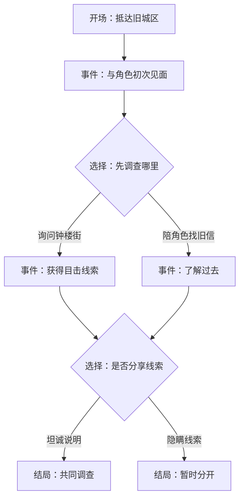

# 酒馆剧情指南：产品需求文档

版本：0.1｜日期：2026-11-13｜当前阶段：首版实现，具体验收状态见 verification.md。

## 1. 产品目标

面向使用 SillyTavern 中文角色卡的玩家，在酒馆内读懂故事、查看事件和分支，并获得互动方向。支持已有世界书的剧情整理，也支持没有世界书时围绕角色创作故事。以 Galgame 的章节、选择、分支和结局作为组织方式，实际游玩仍通过酒馆聊天进行。

用户已确认：中文界面；SillyTavern 扩展形态；通过 Git URL 安装；角色卡/世界书解析；时间线、地点事件、路线、聊天建议；无世界书时创作故事；分支流程图。

本文中的技术方案、容量目标及具体交互为建议默认值，后续实现前验证。本文不代表已完成兼容性测试或发布。

## 2. 问题与证据

用户导入角色卡后难以看清角色时间线、某地点发生的事情与原有故事路线；聊天容易偏离，玩家不知道怎样互动才能探索故事。现有调研仅核对公开文档，未安装实测，不能据此断言没有竞品。

参考项目：

- Story Tracker：追踪聊天中的场景状态。https://github.com/virgilianshailer/story-tracker
- Story Arc：规划未来情节并引导生成。https://github.com/coragon77/StoryArc
- Zeya Status Atelier：开场目录及世界书线路关联。https://github.com/jiuyi777/Zeya-Status-Atelier
- Saga：设定、时间与秘密管理。https://github.com/MentallyQuill/Saga

本项目的优先价值：开局即可获得中文、可核对、可编辑的剧情指南，而不是只在聊天后总结。

## 3. 产品边界

- 运行于 SillyTavern 页面，设置和主面板由扩展提供；不是独立聊天网站。
- Git 仓库发布后可使用酒馆“安装扩展”粘贴 URL 安装；发布地址尚未创建，不提供虚构安装地址。
- 首版支持单角色聊天；群聊支持后置。
- 首版完整覆盖解析与创作、可编辑分支图、手动进度和主动请求互动建议。
- 自动判定聊天进度、严格路线约束、生成后审查及自动修复后置，不能承诺首版彻底消除跑偏。
- 不包含账户系统、云端社区、付费、图片/语音生成和独立服务端。
- 不自动执行世界书脚本，不要求酒馆助手、MVU 或其他插件作为首版依赖。

## 4. 核心概念与信息可信度

### 4.1 两种工作模式

**解析模式**：用户选择当前角色及需要分析的世界书，提取已明确写出的事件、关系、时间、地点、路线与条件。没有写出的关系可作为推断展示，但不能补成作者原设定。没有固定路线时明确显示“原资料未提供固定路线”。

**创作模式**：无世界书也可使用；以角色卡及用户填写的题材、基调、目标和边界生成故事草稿。已有世界书也可主动选择扩写，但原设定与新增内容分层保存。生成章节、冲突、选择、事件、分支和结局，用户审阅、编辑并采用后才成为游玩依据。

### 4.2 内容来源

每条事件、条件、关系和建议都必须标记来源类型：

| 类型     | 含义               | 约束                           |
| -------- | ------------------ | ------------------------------ |
| 原文明确 | 资料直接支持       | 包含可定位的来源及摘录         |
| 模型推断 | 模型解释或推测     | 显著标注，可修改，不能伪造引用 |
| 原创草稿 | 新增故事           | 未采用前不影响游玩             |
| 用户设定 | 玩家手动新增或修改 | 记录修改及版本                 |

聊天建议是建议，不是保证能触发事件的口令。实际语义条件与酒馆世界书激活机制分开展示：关键词、概率和扫描设置不等于剧情条件。

## 5. 用户流程

1. 进入角色聊天，从扩展设置或输入区菜单打开“剧情指南”。
2. 查看识别到的角色和资料列表，选择解析、创作或扩写。
3. 解析时选择资料范围；创作时填写简短故事意向，允许跳过并使用明确展示的默认值。
4. 显示资料量、分批处理计划及将使用的模型连接，点击生成。
5. 展示生成进度、可取消；失败保留已完成草稿，可重试失败批次。
6. 审阅故事概览、事件、地点、路线与流程图，核对来源、修正冲突并采用版本。
7. 游玩时查看当前节点、可探索方向及聊天建议，手动更新进度。
8. 随时保存、导入导出；刷新或切换角色后恢复对应资料。

无世界书不是报错场景：展示“未找到世界书，可基于角色创作故事”，并允许继续。如果角色卡也缺少有效描述，先输入最小人物设定，不能静默生成与角色无关的故事。

## 6. 功能与验收

### FR-01 宿主集成与资料选择（P0）

- 使用原生扩展清单与入口，在酒馆内显示中文面板。
- 支持读取角色描述、背景、首条问候及可用的内嵌/关联世界书；具体字段须经宿主适配验证。
- 列出来源、条目数和包含状态。禁用条目默认不参与，可由用户显式纳入并保留禁用标记。
- 不默认扫描所有角色与全局资料；需要额外资料时由用户选择。
- 验收：有书、无书、空书、多个关联书、重复内嵌条目均可解释处理；不能把无权限/读取失败伪装成无书。

### FR-02 原设定解析（P0）

- 提取事件、人物、地点、相对时间、前后依赖、分歧、结局及触发条件。
- 时间缺失标未知；矛盾来源并列展示，不能自行裁定或编造精确日期。
- 每项事实可跳转来源摘要，含书名、条目 UID/角色字段、原文摘录及资料版本。
- 大书分批提取后合并、去重，保留来源映射和未完成批次，不静默截断。
- 验收：只有人设的卡不得展示“作者指定结局”；无依据的关系被标记推断；无效引用不可作为明确事实采用。

### FR-03 故事创作与扩写（P0）

- 输入：角色资料、故事主题、基调、篇幅偏好、玩家身份和希望避免的内容；非必填项提供可见默认值。
- 输出：故事梗概、章节目标、事件、选择、条件、分支和至少一个可达结局。
- 允许局部重生成；默认保留用户编辑及锁定节点，覆盖前提供差异预览。
- 原资料作为约束，新增内容标原创；冲突必须提示。
- 草稿、采用、归档是明确状态；失败、取消及部分完成不能自动采用。
- 验收：没有世界书可以完成“生成—编辑—采用—查看图”的闭环；新增结局不标为原文明确。

### FR-04 故事指南（P0）

- 中文展示概览、时间线、人物、地点、事件及路线。
- 搜索地点、人物和事件名称；地点详情列相关事件与前置条件。
- 区分背景往事、开局状态、计划中事件和本局已发生事件。
- 聊天建议包含互动目的、话题/行动示例和依据，不替用户自动发消息。
- 验收：点某街道可找到关联事件并回看来源；复制建议不发送；不能把建议说成必定触发。

### FR-05 Galgame 式流程图（P0）

- 节点类型：开场、事件、选择、结局。章节用分组表达。
- 有向连线表示剧情衔接；分支边可设置选择文本和前置条件。
- 支持拖动布局、缩放、定位当前节点、点击查看/编辑节点和边；同时提供列表视图。
- 检查重复 ID、悬空连线、入口缺失、不可达节点、无出口节点及没有可达结局的路线。
- 首版采用有向无环图；回访以不同事件节点表达。拒绝环路并指出涉及节点。
- 剧情条件只存声明式数据和自然语言说明，不执行字符串脚本。
- 验收：可表达共同线分成两条人物线，再汇合或进入不同结局；非法图无法采用且保留草稿供修复。

### FR-06 剧透控制（P0）

- 默认无剧透，只展示当前可见信息及温和互动方向。
- 完整攻略由玩家主动打开；隐藏结局名称、图上隐藏节点及连线数量不能泄漏秘密。
- 搜索、列表、来源摘录与无障碍标签使用同一可见性规则。
- 用户指定当前节点后，可见信息随进度更新；缺少解锁依据时采用保守隐藏。
- 验收：未解锁秘密不会通过搜索结果、图摘要或聊天建议意外出现。

### FR-07 本局进度与游玩辅助（P0 / P1）

- P0：玩家手动设当前节点，标记完成/跳过/未发生，记录选择和简单变量；可撤销。
- 故事图是设计数据，聊天进度是本局数据。同角色不同聊天独立保存，重新开局不继承旧进度。
- P0：用户主动请求下一步建议，可选择使用近期聊天；不自动注入全部攻略。
- P1：自动分析聊天，只提出进度变更候选，明确区分事实、回忆、假设和未来计划。
- P1：可选注入当前节点摘要和边界，设置中明示；不能承诺语言模型严格服从。
- 验收：改写、删除、重生成、分支聊天不能悄悄沿用不可靠进度；无法关联时标“待核对”，不猜测完成状态。

### FR-08 保存、版本与导入导出（P0）

- 保存故事版本、草稿、手动修订、布局、来源快照和本局进度。
- 导出带 schemaVersion 的 JSON；可分别导出故事设计和包含本局进度的备份。
- 导入先校验并预览冲突，提供另存副本或替换，禁止静默覆盖。
- 来源修改后标“资料已变化”；重新解析提供差异，保留已采用版本和手工编辑。
- 存储满、写入失败与迁移失败不得显示保存成功；旧数据保留以便恢复。

## 7. 领域数据要求

以下是逻辑契约，具体类型集中在实现阶段定义，不在各模块重复声明。

| 实体           | 必要信息                                                            |
| -------------- | ------------------------------------------------------------------- |
| SourceSnapshot | 稳定 ID、角色标识、书/字段来源、条目 UID、文本、内容指纹、采集时间  |
| Story          | ID、schemaVersion、版本、模式、标题、角色引用、采用状态、资料指纹   |
| Node           | 稳定 ID、类型、标题、正文摘要、人物、地点、时间表达、来源、剧透级别 |
| Edge           | ID、起点、终点、选择文本、条件、来源                                |
| Condition      | 来源、类型、操作数或人工说明；不支持自动求值时标记需玩家判断        |
| RunState       | 聊天标识、故事版本、当前节点、节点状态、选择记录、变量、修订记录    |
| GenerationJob  | 任务 ID、目标故事/角色、批次、状态、错误、完成结果、取消信号        |

时间排序独立于作者叙述顺序；不确定的事件只表达前后依赖，不能硬排精确日期。进度状态和来源类型不是同一个字段。

变量首版仅支持布尔、有限枚举、数值；比较操作限定为等于、不等于、大小比较与显式 AND/OR。不存在的变量或类型不匹配视为不可计算，不默认满足。

## 8. 示例流程图

以下内容仅用于展示数据结构，不是任何角色卡原设定。

## 9. 非功能要求与成功标准

- 安装：干净的受支持酒馆环境中，以 Git URL 安装后可打开中文面板，无需独立启动服务。真实仓库及版本测试完成后才可宣称支持。
- 中文：界面、错误、生成结构均默认中文；人名专名不强制翻译。
- 可靠性：取消、超时、重复点击、切换角色、模型返回无效 JSON 均有明确结果，不能污染其他角色资料。
- 安全：世界书和模型输出作为不可信内容；不执行 HTML、脚本或提示中的工具命令；不记录密钥。
- 性能目标（待验证）：200 节点/300 边的样例可交互浏览；本地搜索目标 300ms 内响应，生成耗时单独展示，不承诺固定时长。
- 可访问性：键盘可打开详情，焦点可见；图有列表替代，状态不能仅靠颜色区分；窄屏可阅读编辑。
- 成本：生成前显示范围，防重复调用；不默认逐轮调用模型，无自动无限重试。
- 成功标准：所有 P0 验收用例通过；用有世界书、无人设以外资料及多分支样例各完成一次真实酒馆闭环；来源引用有效、角色/聊天隔离正确；实际验证结果另行记录，不捏造准确率。

## 10. 分阶段交付

1. 文档阶段：本 PRD、代码规范、AI 入口约束。
2. 集成验证：核实酒馆版本、角色/世界书读取、模型调用、存储和入口；用最小样例证明宿主能力。
3. P0：两种模式、指南、图编辑、来源、剧透、保存与手动进度闭环。
4. P1：聊天自动进度候选、当前路线提示注入、偏离提醒。
5. P2：群聊、复杂变量、更多图布局与生态集成，另行评估。

每一阶段以可操作验收结果结束，不用页面占位或固定假数据冒充功能。

## 11. 风险与待验证项

- 酒馆版本和模型接口：当前用户实际版本未确认；实现前记录支持范围并测试。
- 大型世界书跨条目依赖：分批可能丢上下文，需要合并和人工修订。
- 自然语言条件不可完全自动求值：保留人工判定，不能误导为确定事件触发器。
- 解析与原创冲突：来源分层、差异预览、采用版本保护。
- 存储方案：拟用宿主设置保存轻量配置，独立持久存储保存正文和版本；须验证配额、迁移、账户隔离与备份，禁止未经验证锁定实现。
- 图组件及框架：实现前完成体积、中文、无障碍、许可证和宿主样式隔离评估。
- 需求自评：目标和 P0 流程明确；最薄弱处为宿主版本兼容与大书模型成本，需集成验证补证据。
